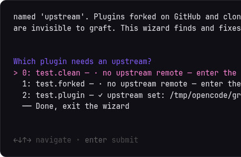
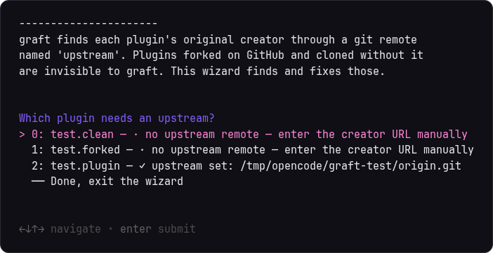
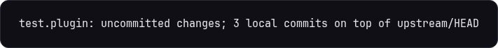

# upstream-plugin-graft

Keep locally-modified Omarchy plugin clones in sync with their original
creators. `omarchy plugin update` fast-forwards, which stops working the
moment you commit your own changes; graft rebases your commits on top of
upstream instead, so both sides land.

```
your clone:  A---B (upstream 1.3)
                  \
                   C---D  (your changes)
after graft: A---B---E---F (upstream 1.4)
                          \
                           C'--D'  (your changes, replayed)
```



## What's here

- `bin/` — the CLI, installed into `~/.local/bin`:
  - `omarchy-plugin-diverged [--json] [id...]` — purely local survey of
    installed git-cloned plugins: which have local commits, uncommitted
    changes, or a paused graft rebase. Exit 0 when at least one needs
    attention, 1 when none do (like `omarchy-update-available`). No network.
  - `omarchy-plugin-graft <id | --all> [--yes]` — fetch the creator's
    default-branch tip, review what's incoming, then:
    - no local commits? behaves exactly like `omarchy plugin update`
      (review + confirm + `--ff-only`)
    - local commits? rebases them onto the upstream tip; a conflict pauses
      the rebase — resolve, `git add`, and re-run the same command to continue
    - fork setups (`upstream` remote, see below): offers to force-with-lease
      push replayed commits back to your fork after grafting
  - `omarchy-plugin-fork <id> [--yes]` — escape hatch: `gh repo fork` the
    origin, rename `origin` → `upstream`, point `origin` at your fork, push
    your local commits. Then vanilla `omarchy plugin update` works again
    (against your fork) and graft keeps tracking the creator.
- `plugin/` — the Omarchy bar widget (`io.github.tmartinppc.plugin-graft`):
  a badge showing the diverged count, hidden when everything is in sync.
  Click opens `omarchy-plugin-graft` in a held-open terminal.

## First launch: tell graft which plugins are forks

Run the setup wizard once after installing:

```sh
omarchy-plugin-fork
```

It surveys every git-managed plugin and classifies each one:

- **already has an `upstream` remote** → shown as done
- **origin is a GitHub fork** → detected automatically via the GitHub API
  (`gh api repos/OWNER/REPO` reports the fork parent); confirming adds the
  `upstream` remote for you, no typing
- **anything else** → you enter the creator's URL manually

Why this matters: cloning your own fork from GitHub creates only an
`origin` remote — git on your machine knows nothing about GitHub's
fork relationship, so without an `upstream` remote graft would treat your
fork as the creator repo and never see the original's changes.



The bar badge is driven by the survey, which reports each plugin's state
in one line (`omarchy-plugin-diverged`):



## Install

```sh
./install.sh          # CLI to ~/.local/bin, plugin symlinked for dev
./install.sh --copy   # plugin installed as a real copy
```

Then enable "Plugin Graft" from the Omarchy bar settings, or:

```sh
omarchy-shell shell enablePlugin io.github.tmartinppc.plugin-graft right
```

Requires: git, jq, gum (all ship with Omarchy), and `gh` for
`omarchy-plugin-fork` only.

## The rebase.pause-on-conflict loop

Graft never force-resets anything. When a rebase hits a conflict it stops
and tells you which files are unresolved; you finish it in the plugin
directory (`git -C ~/.config/omarchy/plugins/<id> status`) and re-run:

```sh
omarchy-plugin-graft bjarneo.workspace-layout   # resumes the paused rebase
```

`git rebase --abort` at any point drops back to your pre-graft state. If an
upstream tip somehow validates as broken, graft rolls back to where you
started (same rule as `omarchy plugin update`).

## Notes

- Scope: third-party plugin clones with a `.git` in
  `~/.config/omarchy/plugins`. First-party clones (`omarchy plugin clone`,
  no git) and symlinked dev plugin folders are out of scope.
- Upstream means the remote's default branch tip (`HEAD`), the same
  granularity `omarchy plugin update` uses.
- The badge refreshes at shell start and before each launcher click; it does
  not poll on a timer.